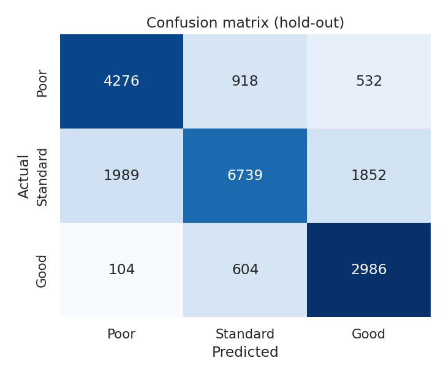
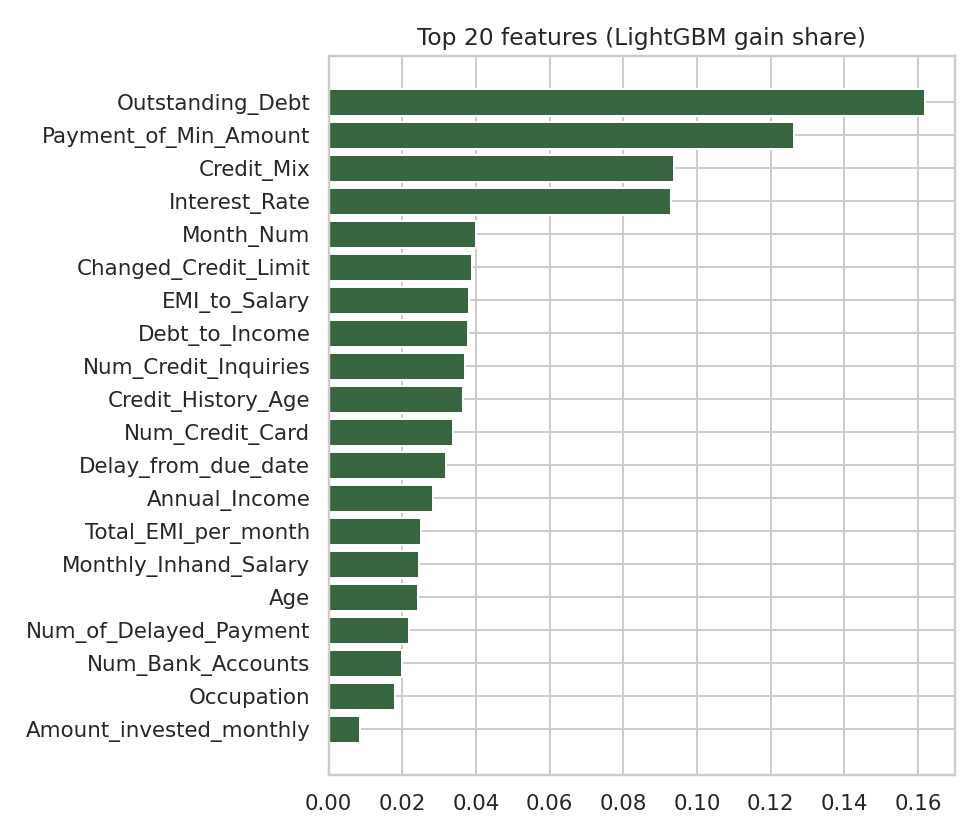
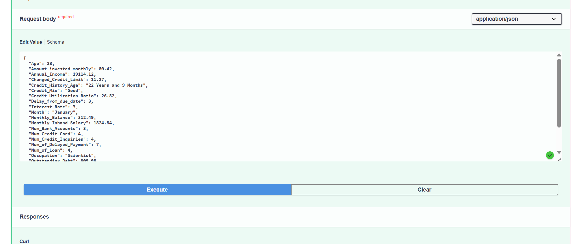
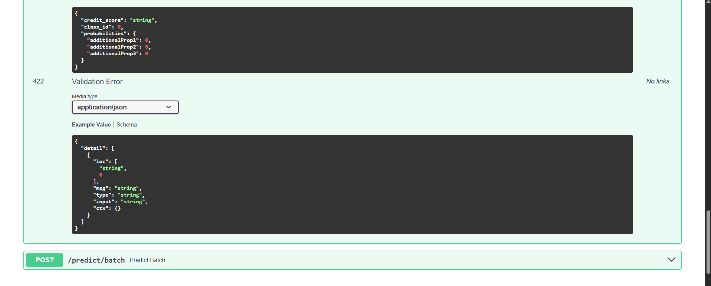

# Smart Credit: Credit Score Classification

A machine learning project for a (fictional) global finance company: given a customer's banking and credit information, classify the credit score as **Poor**, **Standard** or **Good**, and serve the model through a **FastAPI** REST API.

## Highlights
- Cleaning of very messy raw data (placeholder values, `_` noise, impossible numbers) with customer-level imputation
- Four classifiers compared with a **customer-grouped** hold-out split (no leakage between months of the same person)
- Tuned LightGBM model, confusion matrix and feature importance
- REST API with single + batch prediction, Swagger docs, tests, Dockerfile and CI

## Project structure
```
.
├── data/raw/                  train.csv.gz, test.csv.gz (gzip-compressed so they fit GitHub upload limits)
├── creditscore/               reusable package
│   ├── config.py              paths, labels, valid ranges
│   ├── cleaning.py            cleaning + feature engineering
│   ├── modeling.py            pipelines, comparison, tuning, saving
│   ├── plots.py               figures
│   ├── predict.py             load model + score records
│   └── train.py               end-to-end training  (python -m creditscore.train)
├── api/                       FastAPI app (main.py) and schemas
├── notebooks/                 01_credit_score_analysis.ipynb (EDA + modelling, executed)
├── scripts/                   call_api.py (demo client), build_notebook.py
├── tests/                     pytest suite
├── models/                    credit_score_model.joblib
├── reports/                   metrics.json, test_predictions.csv, figures/
├── docs/api_demo_output.txt   real output of the API demo client
├── api_requests.http          click-to-send API requests (VS Code REST Client)
├── .vscode/                   settings, launch configs, tasks, recommended extensions
├── Dockerfile, requirements*.txt, .github/workflows/ci.yml
```

## Data
| File | Rows | Notes |
|---|---|---|
| train.csv.gz | 100,000 | 12,500 customers x 8 months, with `Credit_Score` |
| test.csv.gz | 50,000 | same columns, **no target** - predictions only |

Class balance in train: Standard 53%, Poor 29%, Good 18%.

## Method
1. **Cleaning** - underscores stripped, placeholders (`_`, `NM`, `!@9#%8`) set to missing, out-of-range values (e.g. age -500) set to missing, then filled from the same customer's other months; leftovers get median/mode imputation inside the pipeline.
2. **Features** - credit history in months, one flag per loan type, debt/EMI/balance/investment ratios.
3. **Validation** - 80/20 split grouped by `Customer_ID`; metric = macro F1 (classes are imbalanced); balanced class weights.
4. **Tuning** - small grid on LightGBM; best params saved in `reports/metrics.json`.

## Results (hold-out, unseen customers)
| Model | Accuracy | Macro F1 |
|---|---|---|
| Random Forest | 0.710 | 0.696 |
| LightGBM | 0.700 | 0.694 |
| HistGradientBoosting | 0.697 | 0.691 |
| Logistic Regression | 0.671 | 0.666 |

Final model: **LightGBM** (accuracy 0.700, macro F1 0.694). Per class F1: Poor 0.71, Standard 0.72, Good 0.66. Top drivers: outstanding debt, paying only the minimum amount, credit mix, interest rate.
Random Forest is slightly ahead on this split, but LightGBM was chosen as the deployed model because it is much faster to train and predict and far smaller to ship (about 3.6 MB). Plain logistic regression is clearly weaker, which shows non-linear structure in the data.




## Setup (VS Code)
```bash
git clone https://github.com/<your-username>/<your-repo>.git
cd <your-repo>
python -m venv venv
venv\Scripts\activate            # Windows   (Linux/macOS: source venv/bin/activate)
pip install -r requirements-dev.txt
```
In VS Code choose the `venv` interpreter (`Ctrl+Shift+P` > *Python: Select Interpreter*), then use **Run and Debug** (*Run API*, *Call API demo client*, *Train model*, *Run tests*). Click requests in `api_requests.http` (REST Client extension) to test the API without leaving VS Code. Full walkthrough: [docs/VSCODE_GUIDE.md](docs/VSCODE_GUIDE.md).

## Train
```bash
python -m creditscore.train      # ~4 min on 1 CPU: comparison, tuning, saves model + predictions
```

## Run the API
```bash
uvicorn api.main:app --reload
```
Open http://127.0.0.1:8000/docs for the interactive Swagger UI. If `models/credit_score_model.joblib` is missing the API trains it on first start (`RETRAIN=1` forces retraining).

| Method | Endpoint | Purpose |
|---|---|---|
| GET | `/health` | service + model status |
| GET | `/model-info` | classes, params, hold-out metrics |
| POST | `/predict` | one record |
| POST | `/predict/batch` | up to 1000 records |

All input fields are optional; missing ones are imputed.

### API connection demo
```bash
python scripts/call_api.py            # calls all endpoints; real output in docs/api_demo_output.txt
```
or with curl:
```bash
curl -X POST http://127.0.0.1:8000/predict -H "Content-Type: application/json" -d '{"Age": 28, "Occupation": "Scientist", "Annual_Income": 19114.12, "Monthly_Inhand_Salary": 1824.84, "Num_Bank_Accounts": 3, "Num_Credit_Card": 4, "Interest_Rate": 3, "Num_of_Loan": 4, "Delay_from_due_date": 3, "Num_of_Delayed_Payment": 7, "Num_Credit_Inquiries": 4, "Credit_Mix": "Good", "Outstanding_Debt": 809.98, "Credit_Utilization_Ratio": 26.82, "Credit_History_Age": "22 Years and 9 Months", "Payment_of_Min_Amount": "No", "Payment_Behaviour": "High_spent_Small_value_payments", "Monthly_Balance": 312.49}'
```
Response (real output from the running service):
```json
{"credit_score": "Good", "class_id": 2, "probabilities": {"Poor": 0.0236, "Standard": 0.0782, "Good": 0.8982}}
```
### API screenshots

Swagger UI prediction:



Demo client output (all endpoints):




## Tests
```bash
python -m pytest -q
```

## Docker
```bash
docker build -t credit-score-api .
docker run -p 8000:8000 credit-score-api
```

## Limitations
- ~70% accuracy on unseen customers; the *Standard* class is the hardest to separate. Not suitable for real lending decisions.
- The API scores one customer-month at a time; it cannot use the customer's other months the way the batch training pipeline does for imputation.
- `test.csv.gz` has no labels, so test accuracy cannot be computed; `reports/test_predictions.csv` contains predictions only.

## Author
Md.Shaurov Hayat Emon - shaurovemon@gmail.com
